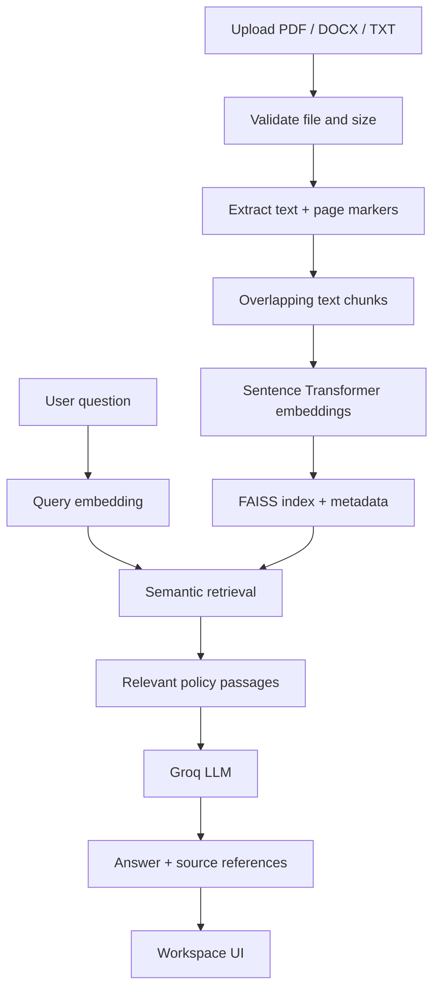

<div align="center">

# ✳ PolicyPilot — Policy Document AI

### Understand every clause. Ask better questions. Make informed decisions.

**A retrieval-augmented policy assistant built with FastAPI, FAISS, Sentence Transformers and Groq.**

[](https://python.org)
[](https://fastapi.tiangolo.com/)
[](https://github.com/facebookresearch/faiss)
[](https://groq.com/)

[✨ Features](#-what-it-can-do) · [⚡ Quick start](#-run-it-locally) · [🧠 Architecture](#-how-it-works) · [🔌 API](#-api-reference) · [🚀 Deploy](#-deployment)

</div>

---

## ✨ What it can do

| Capability | What happens |
|---|---|
| 📄 Document ingestion | Upload PDF, DOCX, or TXT policies (15 MB default limit). |
| 🧩 Text extraction | Extract readable text, DOCX tables, and PDF page markers. |
| ✂️ Chunking | Split long policies into overlapping passages. |
| 🔎 Semantic retrieval | Sentence Transformer embeddings + FAISS similarity search. |
| 💬 Grounded answers | Groq explains relevant clauses, limitations, waiting periods, and exclusions. |
| 📚 Evidence references | Return filenames, page metadata, and retrieval relevance scores. |
| 🖥️ Workspace UI | Responsive chat, drag-and-drop upload, indexed document library, and suggested prompts. |

> **Important:** This is an informational document assistant, not an insurer, broker, legal adviser, or claim approval service. AI output is not a coverage guarantee. Verify important decisions with the insurer and original policy wording.

## 🧭 Contents

- [Architecture](#-how-it-works)
- [Project layout](#-project-layout)
- [Run locally](#-run-it-locally)
- [Environment variables](#-environment-variables)
- [API reference](#-api-reference)
- [Deployment](#-deployment)
- [Limitations](#-limitations--troubleshooting)
- [Roadmap](#-roadmap)

## 🧠 How it works



1. **Ingest:** validate, extract, chunk, embed, and rebuild the local FAISS index.
2. **Retrieve:** embed the question with the same model and search normalized vectors.
3. **Reason:** provide retrieved excerpts to the LLM and instruct it to disclose uncertainty.
4. **Review:** inspect the answer and returned filename/page references.

## 📁 Project layout

```text
Policy-Document-RAG/
├── app/
│   ├── main.py                 # FastAPI app, static UI, health endpoint
│   ├── config.py               # Environment and path configuration
│   ├── routes/
│   │   ├── query.py            # Grounded question endpoint
│   │   └── uploads.py          # Upload, indexing, document library
│   └── services/
│       ├── parser.py           # PDF, DOCX, TXT extraction
│       ├── chunker.py          # Overlapping text chunks
│       ├── embedder.py         # Sentence Transformer embeddings
│       ├── retriever.py        # FAISS persistence and search
│       └── llm_reasoner.py     # Groq answer generation
├── frontend/
│   ├── index.html              # PolicyPilot workspace
│   ├── style.css               # Responsive dark UI
│   └── script.js               # Upload and chat interactions
├── prompts/                    # Prompt templates retained for extension
├── data/uploads/                # Runtime uploads (git-ignored)
├── vector_store/                # Runtime FAISS data (git-ignored)
├── index_documents.py           # Optional bulk indexing utility
├── requirements.txt
├── run.py
├── .env.example
└── README.md
```

## ⚡ Run it locally

### 1. Requirements

- Python 3.10+
- A Groq API key
- Internet access on first startup to download the embedding model

### 2. Clone and install

```bash
git clone https://github.com/codingwithdinu/Policy-Document-RAG.git
cd Policy-Document-RAG
python -m venv .venv

# Windows PowerShell
.venv\Scripts\Activate.ps1
# macOS / Linux
# source .venv/bin/activate

pip install -r requirements.txt
```

### 3. Configure secrets

Copy `.env.example` to `.env`, then add your own key:

```env
GROQ_API_KEY=your_groq_api_key
GROQ_MODEL=openai/gpt-oss-120b
EMBEDDING_MODEL=all-MiniLM-L6-v2
MAX_UPLOAD_MB=15
```

Get a key from the [Groq Console](https://console.groq.com/). Never commit your real `.env`.

### 4. Start

```bash
python run.py
```

Open **http://localhost:8000**. Interactive API docs: **http://localhost:8000/docs**. Health endpoint: **http://localhost:8000/health**.

### 5. Ask your first question

1. Upload a text-readable policy PDF, DOCX, or TXT.
2. Wait for the successful indexing message.
3. Ask “What is the waiting period for pre-existing diseases?”
4. Review the answer and its evidence references.

## 🔐 Environment variables

| Variable | Required | Default | Purpose |
|---|---:|---|---|
| `GROQ_API_KEY` | For answers | — | Groq API authentication |
| `GROQ_MODEL` | No | `openai/gpt-oss-120b` | Chat model identifier |
| `EMBEDDING_MODEL` | No | `all-MiniLM-L6-v2` | Embedding model |
| `MAX_UPLOAD_MB` | No | `15` | Upload size limit |

## 🔌 API reference

Base URL: `http://localhost:8000`

<details>
<summary><strong>GET /health</strong> — health check</summary>

```bash
curl http://localhost:8000/health
```
Example: `{"status":"ok","service":"policy-document-ai"}`
</details>

<details>
<summary><strong>POST /upload</strong> — upload and index a policy</summary>

```bash
curl -X POST http://localhost:8000/upload -F "file=@./sample-policy.pdf"
```
Returns saved filename, byte count, and indexed chunk count. Supported formats: PDF, DOCX, TXT.
</details>

<details>
<summary><strong>GET /documents</strong> — list uploaded documents</summary>

```bash
curl http://localhost:8000/documents
```
Returns filenames, file sizes, chunk counts, and index status.
</details>

<details>
<summary><strong>POST /query</strong> — ask about your policy</summary>

```bash
curl -X POST http://localhost:8000/query \
  -H "Content-Type: application/json" \
  -d '{"query":"What is the waiting period for hospitalisation?"}'
```
Returns query, answer, retrieved clauses, and source metadata.
</details>

## 🚀 Deployment

This is a **single-origin FastAPI service**: backend routes and frontend assets are served by the same application.

### Render

1. Create a Web Service and connect this repository.
2. Choose the Python runtime.
3. Build command: `pip install -r requirements.txt`
4. Start command: `python run.py`
5. Add `GROQ_API_KEY` as a secret environment variable in Render.
6. Attach a persistent disk mounted at `/var/data` and set `DATA_DIR=/var/data` in environment variables. This keeps uploaded policies and the FAISS index across restarts and deploys.
7. Set `GROQ_MODEL` to a model currently available in your Groq account if the default model is unavailable.
8. Deploy and check `/health`, `/`, and `/docs`.

The server reads the platform-provided `PORT`. Local filesystems on many hosts are ephemeral; use a persistent disk or object storage for durable uploads and index data.

## 🧯 Limitations & troubleshooting

| Symptom | Likely cause | Action |
|---|---|---|
| No readable text | Scanned/image-only PDF | OCR it first; OCR is not included. |
| No relevant clauses | No indexed documents or different policy wording | Check document library and ask a more specific question. |
| Missing API key | `GROQ_API_KEY` is unset | Add it to `.env` or hosting secrets. |
| Model download fails | Network restrictions | Allow outbound model download on first start. |
| Files disappear after redeploy | Ephemeral filesystem | Configure persistent storage. |
| Answer is uncertain | Evidence incomplete or ambiguous | Inspect the original clause and confirm with the insurer. |

### Security notes

- Keep credentials in environment variables; never hard-code API keys.
- Do not upload sensitive documents to a public demo or shared machine.
- Production needs authentication, per-user storage isolation, malware scanning, deletion controls, and persistent storage.
- Revoke and rotate any credential that was previously committed publicly.

## 🛠️ Roadmap

- [ ] Authentication and per-user workspaces
- [ ] Persistent object storage and managed vector database
- [ ] OCR for scanned policies
- [ ] Document deletion and re-index controls
- [ ] Automated retrieval and API tests
- [ ] More precise clause-level citations and downloadable analysis

## 🤝 Contributing

Issues and pull requests are welcome. Include reproduction steps, expected behaviour, and relevant logs—never secrets or private policy contents.

## 📄 License

No license file was present when this README was updated. Add a license that matches your intended reuse terms before presenting the project as open source.

---

<div align="center">

**Built with care for clearer policy understanding.**  
[Back to top ↑](#-policypilot--policy-document-ai)

</div>
